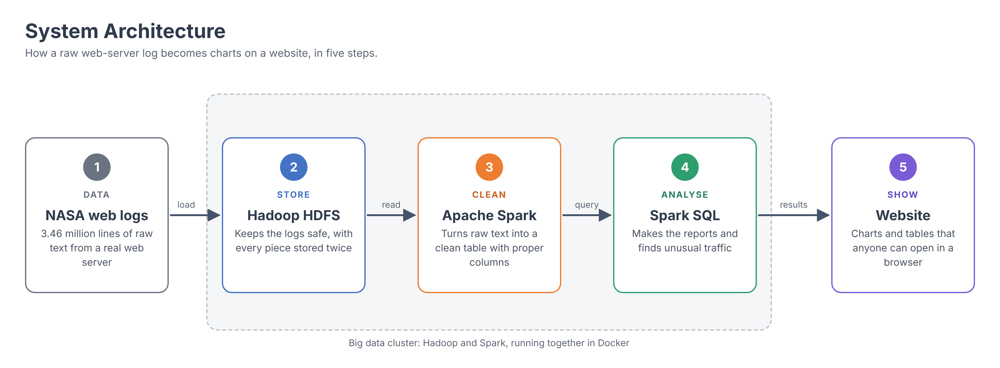
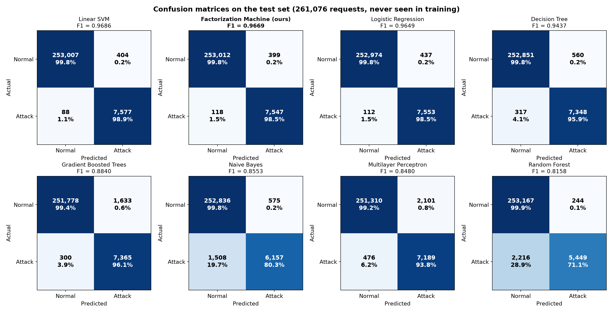

# Log Analytics System for a Web Server

A distributed **Hadoop HDFS + Apache Spark** pipeline that turns raw web-server access logs into
reports, unusual-traffic alerts and web-attack detection. Demonstrated on the real NASA-HTTP logs
(July–August 1995, 3.46 million requests).

**Team:** Kushal Mohan (RA2411028010082) · Kriti Singh (RA2411028010081) · Gargi Singh (RA2411028010102)
**Guide:** Dr. Senthil Kumar K · SRM Institute of Science and Technology · Big Data Essentials



## Pipeline

| Stage | Big data tool | Owner | Code | Result |
|---|---|---|---|---|
| Store | **Hadoop HDFS** in Docker (1 NameNode, 2 DataNodes, replication 2) | Kriti | `docker/`, `docker-compose.yml`, `conf/` | 356 MB raw logs, every block stored twice |
| Clean | **Apache Spark** (PySpark ETL) | Kushal | `jobs/etl.py` | 3,461,613 lines → 3,461,612 rows, 1 reject, 58 date folders of Parquet (41.5 MB) |
| Analyse | **Spark SQL** | Gargi | `jobs/reports.py`, `jobs/anomalies.py`, `jobs/export_dashboard.py` | 11 reports; Z-score finds 12 unusual hours (13 July 1995, STS-70 launch) |
| Detect attacks | **Spark MLlib** | Team | `jobs/ml_preprocess.py`, `jobs/ml_train.py`, `jobs/ml_crossdataset.py` | Factorization Machine, F1 0.967, compared with 7 models (see [ML.md](ML.md)) |

## Run it

Needs Docker Desktop (8 GB memory for Docker), `make`, `curl`.

```bash
make data          # download the NASA logs into ./data (356 MB)
make build         # build the image: Java 11, Hadoop 3.3.6, Spark 3.5.3
make up            # start the 7 containers, wait for HDFS
make skeleton      # ingest -> etl -> reports -> anomalies -> dashboard
make ml            # attack data -> HDFS -> preprocessing -> 8 models -> output/ml/ml_report.html
```

| URL | What |
|---|---|
| http://localhost:8050 | Website (Overview, Traffic, Errors, Performance, Attack detection) |
| http://localhost:9870 | HDFS NameNode |
| http://localhost:8080 | Spark master |

Run `make` on its own to list every target. On a Mac, double-click `run_pipeline.command` to build, start and run everything. No Docker? Open `notebooks/LogAnalytics_Colab.ipynb`
in Google Colab and use Runtime → Run all.

## Results

**Preprocessing:** raw text → 11 typed columns (`docs/preprocessing_*.png`).

**Machine learning** (test set of 261,076 labelled requests):

| Model | Precision | Recall | F1 |
|---|---|---|---|
| Linear SVM | 0.9494 | 0.9885 | 0.9686 |
| **Factorization Machine (ours)** | 0.9498 | 0.9846 | **0.9669** |
| Logistic Regression | 0.9453 | 0.9854 | 0.9649 |
| Decision Tree | 0.9292 | 0.9586 | 0.9437 |
| Gradient Boosted Trees | 0.8185 | 0.9609 | 0.8840 |
| Naive Bayes | 0.9146 | 0.8033 | 0.8553 |
| Multilayer Perceptron | 0.7738 | 0.9379 | 0.8480 |
| Random Forest | 0.9571 | 0.7109 | 0.8158 |



**Across datasets:** trained on Fwaf and tested on HttpParams, the Factorization Machine keeps F1 0.973,
against 0.902 for Logistic Regression and 0.851 for Linear SVM. Details in [ML.md](ML.md).

## Team guides

[KRITI.md](KRITI.md) (HDFS cluster) · [KUSHAL.md](KUSHAL.md) (Spark ETL) · [GARGI.md](GARGI.md) (Spark SQL + website) · [ML.md](ML.md) (machine learning)

To run only the website (no Docker): `pip install -r requirements-gargi.txt`, then
`cd web && OUTPUT_DIR=../output python app.py` after the pipeline has filled `output/`.

## Layout

```
docker/            Dockerfile + entrypoint.sh (one image, a role per container)
docker-compose.yml the 7-container cluster
conf/              core-site.xml, hdfs-site.xml, spark-defaults.conf
jobs/              Spark jobs: etl, reports, anomalies, export_dashboard, ml_preprocess, ml_train
web/               Flask website: Overview, Traffic (with Z-score anomalies), Errors, Performance, Attack detection
scripts/           data download scripts
notebooks/         Google Colab version of the pipeline
docs/              figures and ML results
data/, output/     created locally, not in git
```
